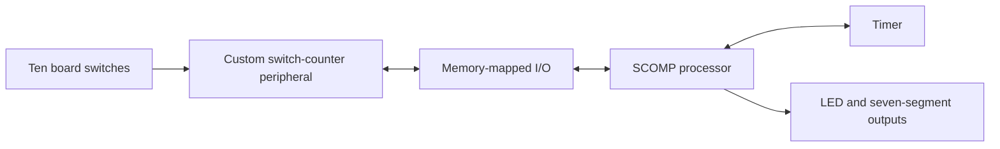

# FPGA Switch Counter Game

**A hardware/software co-design project for the DE10-Standard and SCOMP processor.**

A two-player switch-counting game concept built around a custom memory-mapped VHDL peripheral. The peripheral monitors ten switches and keeps independent 16-bit transition counters, while SCOMP software can configure and read the hardware.

## Architecture

## Custom peripheral

[`DIG_IN.vhd`](DIG_IN.vhd) defines `SWITCH_CNT`. It compares sampled switch states and counts falling, rising, or both transitions.

| I/O address | Purpose |
|---|---|
| `0x60–0x69` | Read the ten switch counters |
| `0x6A` | Read current switch states |
| `0x6B` | Write edge configuration: 0 falling, 1 rising, 2 both |
| `0x6C` | Write a ten-bit counter-reset mask |

The peripheral drives the shared data bus during selected reads. Its source also implements writes to individual counter addresses.

## Source files

| File | Role |
|---|---|
| [`DIG_IN.vhd`](DIG_IN.vhd) | Switch edge detection and counters |
| [`SCOMP.vhd`](SCOMP.vhd) | Soft processor |
| [`TIMER.vhd`](TIMER.vhd) | Timer peripheral |
| [`DIG_OUT.vhd`](DIG_OUT.vhd) | Digital outputs |
| [`HEX_DISP.vhd`](HEX_DISP.vhd) | Seven-segment display interface |
| [`clk_div.vhd`](clk_div.vhd), [`PLL_main.vhd`](PLL_main.vhd) | Clock-related modules |

## Intended game behavior

Two players toggle SW0 and SW9 during a timed round. The software sequence resets scores, waits for a start, runs a countdown, configures transition counting, and updates scores and remaining time on the displays.

## Reproduction status

This repository contains the VHDL source subset. The described SCOMP assembly game program, complete Quartus project/top-level integration, pin assignments, and memory initialization artifacts are not checked in, so a fresh clone cannot reproduce the complete board game yet.

Open the sources in the matching Quartus/DE10-Standard environment and supply those integration artifacts before attempting a hardware build. Input synchronization, mechanical switch debouncing, write timing, and reset behavior need further verification. No new synthesis or board test was performed during this documentation update.

**Engineering focus:** VHDL · FPGA peripherals · memory-mapped I/O · hardware counters · assembly interfaces

[Ian Hall's engineering portfolio](https://github.com/Iwetter)
